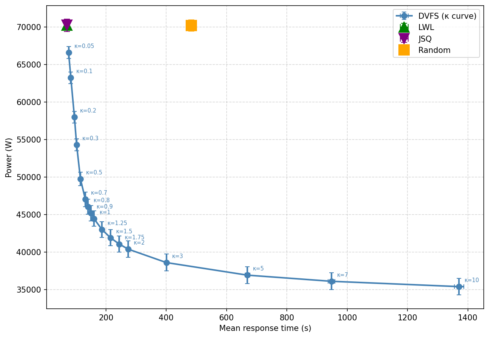

# Calibrated Speed Scaling
**Joint Energy and Delay Optimization in Multi-Server Systems**

MSc thesis, Data Science, Sapienza University of Rome (2026)
Supervisors: Prof. Andrea Baiocchi, Prof. Paolo Di Lorenzo · Co-advisor: Mert Yıldız

## Overview
Data-center servers can save energy by running slower (DVFS), but slower servers
mean longer response times. This project builds a dispatching and speed-scaling
policy that trades the two off through a single knob κ, and corrects a
calibration error that makes the standard M/G/1-based speed rule **5.8× too
slow** in a 100-server cluster.

## Problem
Electricity is one of the largest operating costs of a data center, yet jobs
must still be served quickly. Each arriving job raises two questions: which
server should take it, and how fast should every server run? The goal is to
minimise long-run average power + κ · mean response time.

## Approach
- **Lyapunov drift-plus-penalty**: turns the long-run objective into a decision per arrival.
- **Closed-form speed rule**: μ\* = μ_max · min(1, √(U / (3κψE[C]))), where U is the server backlog.
- **Φ-minimisation routing**: each job goes to the server with the lowest marginal cost.
- **ψ_{M/G/n} calibration (main contribution)**: replaces the M/G/1 Pollaczek–Khinchine
  factor with an Erlang-C–corrected (Lee–Longton) version, computed in log-space so it
  stays stable for large n.
- **Workloads**: Poisson arrivals with Weibull job sizes (tunable CoV), and Google
  Cluster Data 2019 (Cell a, 1.15M jobs).
- **Baselines**: LWL (least work left), JSQ, Random, all at full speed.

## Key results


| Setting | Power saving vs LWL | Mean response time |
|---|---|---|
| Synthetic benchmark (n=100, ρ=0.7, CoV=2, κ=1) | **36.6%** | 2.3× LWL (P95: 1.43×) |
| Load sweep, ρ = 0.3 → 0.9 | 49.7% → 15.8% | ≤ 3× LWL |
| Scale sweep, n = 10 → 1000 | 33.1% → 37.3% | ≈ 2.3× LWL |
| Job-size variability, CoV = 0.5 → 5 (ρ=0.6) | 59.7% → 28.2% | — |
| Google Cluster Data 2019, κ=1 | **8.9%** | 1.01× LWL |
| Google, κ = 0.5 → 2 | 7.0% → 11.0% | 1.007× → 1.018× LWL |

- Calibration matters: with the M/G/1 factor the same policy has a mean response
  time of 923.9 s instead of 160.4 s (n=100, ρ=0.7).
- On real traffic the saving is smaller but almost free in delay; κ ∈ [0.5, 2]
  is a safe default in both settings.

## Repository layout
```
src/css/                 simulator package
  engine.py              event-driven simulator (all policies)
  psi.py                 Erlang-C, ψ_{M/G/1}, ψ_{M/G/n}
  workloads.py           Weibull workload, Google trace loader
  stats.py               multi-seed runs with Student-t confidence intervals
  config.py              default parameters (thesis Table 6.1)
experiments/
  run_experiments.py     runs the experiments → results/*.json, *.npz
  make_figures.py        builds results/figures/*.png from saved results
results/                 saved results and figures used in the thesis
tests/                   unit tests (ψ limits, Weibull moments)
```

## How to run
```bash
pip install -r requirements.txt
python -m pytest                                      # unit tests
python experiments/run_experiments.py --exp rho kappa # selected experiments
python experiments/make_figures.py                    # figures from saved results
```
Google trace: see [`data/README.md`](data/README.md).
Run times (single core): sweeps 20–120 min each; benchmark-length experiments
(10⁶ jobs × 5 seeds) about 75 min.

## Known limitations
- In the Google trace loader each job size is paired with the inter-arrival
  gap before it rather than after it (one-position shift). Kept as-is so the
  repository reproduces the thesis numbers exactly.
- The ρ sweep keeps the hardware fixed (μ_max set at ρ=0.7), while the CoV
  scenarios rescale μ_max with ρ; results at the same ρ are not comparable
  across the two experiments.

## My contribution
I wrote the simulator from scratch, derived and validated the ψ_{M/G/n}
correction, ran all experiments, and built the Google trace pipeline. The base model formulation comes from the supervisors' working notes.

## Thesis
The full thesis is available on request; a paper based on this work is in
preparation.

## License
Code: MIT (see [`LICENSE`](LICENSE)). To cite this work, see [`CITATION.cff`](CITATION.cff).
